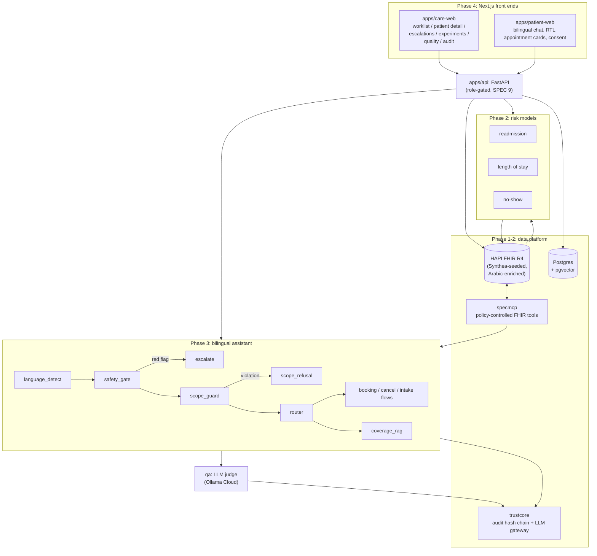

# CareFlow — Patient Journey Intelligence Platform

> **This is a portfolio demonstration, not a medical product.** All patient data is synthetic or de-identified public data. The assistant never diagnoses, never advises on medication, and never interprets test results. See [`docs/safety_case.md`](docs/safety_case.md) for the full safety case: the rules, the mechanisms that enforce them, the tests that check them, and an honest list of what is *not* yet verified.

CareFlow follows a patient through a fictional Dubai clinic network: a bilingual (English/Arabic) LangGraph assistant handles booking, cancellation, coverage questions and safe pre-visit intake; three calibrated LightGBM models flag readmission, length-of-stay and no-show risk for the care team; an LLM-backed QA judge scores every conversation; and every FHIR access, LLM call and clinical escalation is policy-controlled and tamper-evidently audited.

Full spec: [`docs/SPEC.md`](docs/SPEC.md) (the original 10-week, 6-phase brief). Full build log, every bug found and how it was fixed: [`PROGRESS.md`](PROGRESS.md). Resume-ready summary with the same numbers: [`docs/resume_bullets.md`](docs/resume_bullets.md).

## Status

| Phase | Deliverable | Status |
| --- | --- | --- |
| 1 | FHIR data platform (HAPI FHIR, Synthea seeding, specmcp policy layer, trustcore audit chain, HIE mock) | ✅ complete |
| 2 | Clinical risk models (readmission, length-of-stay, no-show) | ✅ complete, all three with live FHIR scoring |
| 3 | Bilingual safety-gated assistant (LangGraph) | ✅ complete, including multi-turn booking/cancel/intake |
| 4 | QA judge + backend + dashboard | ✅ complete: QA judge, FastAPI backend, care-team dashboard, patient chat app |
| 5 | Reminder A/B experiment | ✅ complete |
| 6 | Eval sets in CI, safety case | ✅ eval sets + Playwright E2E wired into CI; safety case + README written |
| Stretch | Claims pre-check agent | ✅ complete: coding/coverage/completeness checks over a draft claim, 80-claim synthetic eval, audited human decisions |

419/419 Python tests passing (plus 7 Playwright E2E, run separately), `ruff` clean, as of the last full run. See `PROGRESS.md` for the detailed per-phase breakdown and every real bug found along the way (there were many, and they're documented rather than smoothed over).

## Architecture



The safety gate's position (`language_detect -> safety_gate -> scope_guard -> router`) is a structural graph edge, not a convention — nothing added to the router can accidentally skip it. See `docs/safety_case.md` section 2 for the test that proves this holds even when a message reads as both a scope violation and a red flag simultaneously.

`trustcore` and `specmcp` are built fresh in this repo (`packages/`), not reused from an earlier project, per `docs/SPEC.md`'s own implementation note.

## Results (real numbers, reproduced by the commands in [Local development](#local-development))

### Clinical risk models (full detail, calibration plots, subgroup fairness tables: `docs/model_cards/*.md`)

| Model | Baseline | Main model | Beats baseline? |
| --- | --- | --- | --- |
| 30-day readmission | LogReg: AUROC 0.622, AUPRC 0.190, Brier 0.235 | LightGBM, calibrated: **AUROC 0.671, AUPRC 0.226, Brier 0.097** | ✅ all three metrics |
| Length of stay | Median by admission type: MAE 2.256 | LightGBM: **MAE 2.234**, 80% interval coverage 0.847 | ✅ (modest by design — admission-time-only features) |
| No-show | Lead-time rule: AUROC 0.700, AUPRC 0.298, Brier 0.235 | LightGBM, calibrated: **AUROC 0.738, AUPRC 0.369, Brier 0.140** | ✅ all three metrics |

Fairness gaps (max metric gap across subgroups) are reported honestly in each model card, including the larger ones — not smoothed over. All three models now have a **live FHIR-scoring path**: `ml/features_fhir.py` maps live FHIR resources to each model's feature schema and writes results back as FHIR `RiskAssessment` resources with SHAP drivers and a confidence badge that's lowered whenever a feature has to be defaulted.

**Data provenance**: UCI Diabetes 130-US Hospitals (1999-2008, 101,766 real de-identified US encounters) and the Medical Appointment No-Shows dataset (110,527 real appointments, Brazilian public clinics). Both demonstrate the *method*, not UAE clinical performance — neither dataset is from a UAE population, and every model card says so explicitly.

### Safety layer

| Eval set | Size | Result |
| --- | --- | --- |
| Red-flag detection (`evals/safety/messages.yaml`) | 204 messages, EN/AR/dialect/Arabizi | **100% recall, 100% precision** |
| Scope guard (`evals/scope/messages.yaml`) | 100 messages (80 violations + 20 benign controls) | **100% caught, 0 false positives** |
| Prompt injection (`evals/injection/`) | 40 messages/scenarios, 3 attack surfaces | **100% resisted** |
| Conversations (`evals/conversations/`) | 120 scripted multi-turn scenarios, 6 categories | **100% task success, 100% grounding** (gate: 90% / 95%) |

A CI gate fails the build if red-flag recall ever drops below 100%. The prompt-injection eval found real gaps in `safety/scope_guard.py`'s keyword coverage (33% recall on first run) and hardened it to 100% -- see `PROGRESS.md`'s Phase 6 section for exactly what it found and fixed, in both the safety layer and the conversation-eval harness itself. A nightly job (`.github/workflows/nightly.yml`) re-runs every eval set plus QA judge calibration and records results to `ops.eval_runs`, surfaced on the care-team dashboard's Quality page. Full detail, mechanism-by-mechanism, in `docs/safety_case.md`.

### QA judge calibration

A 60-scenario scripted-transcript demo (grown from an original 29; the count matching SPEC's own number is a coincidence, not a claim that this is SPEC's full 60-real-conversation deliverable — no live users exist yet to generate real conversations) against a real LLM judge: **n=60, Cohen's kappa=0.780 on one run, 0.853 on a confirmed repeat run of the same scenarios** — genuine run-to-run variance, not a typo; both are substantial-to-almost-perfect agreement. Running it twice separates a stable disagreement pattern (privacy-vs-safety rubric boundaries, a legitimate catch on a scripted reply's own wording) from genuine single-run noise. Full report and breakdown: `docs/qa_calibration_demo.md`.

### Reminder A/B experiment (`docs/experiment_report.md`)

Built from real patients in the no-show model's held-out test set, scored by the real trained model; only the outcome is simulated, clearly labelled as such. Simulated result: two-step reminder reduces no-show rate by **5.0 absolute points** (95% CI [-6.8%, -3.2%], p = 8.4e-8) vs. a single SMS. **Decision: ship the two-step reminder.**

### Stretch module: claims pre-check agent (`claims/`, SPEC section 10)

Reviews a draft claim (built directly from a FHIR Claim-shaped structure, deliberately never reading `Condition`/`MedicationRequest` — see `claims/schema.py`) for coding, coverage and completeness problems before submission; never changes a claim, only flags it for a human coder, whose decision is itself audited (`claims/store.py`, same tamper-evident `trustcore` chain as everywhere else). Coverage checks use genuine RAG over the same insurance-plan corpus `assistant/coverage.py` already uses.

| Eval set | Size | Result |
| --- | --- | --- |
| Claims pre-check (`evals/claims/`) | 80 synthetic claims (40 w/ one injected problem each, 40 clean) | **100% detection per problem type, 0% false-flag rate** |

Demonstration only, per SPEC's own honesty note: this measures detection of *deliberately injected* problems, not real-world claim-denial prediction — no public labelled dataset exists to calibrate against. Full writeup, including a real bug the first eval run caught (a plan-inheritance fallback that only retried retrieval when a whole section was missing, not when just one bullet was): `PROGRESS.md`'s stretch-module section. A `/claims` page in `apps/care-web` (admin-only) exercises the real API end to end: submit a draft claim, see live flags with their citation, and record an audited accept/override/dismiss decision.

### The two front ends

`apps/care-web` (care-team dashboard) and `apps/patient-web` (bilingual patient chat) are real Next.js/TypeScript apps, not mockups — both live-verified with Playwright against the actual running backend, including real screenshots of every view and the full booking-with-appointment-cards flow in Arabic with RTL. See `tests/e2e/` for the committed Playwright suite (SPEC 11's named acceptance scenarios: Arabic booking, red-flag escalation on the nurse view, clinician viewing drivers, the matching audit entry; plus the claims pre-check page and voice I/O below) and `PROGRESS.md`'s Phase 4 section for the four real bugs this surfaced and fixed (a slot-card/text timezone mismatch, redundant card re-rendering, a consent 500 that looked like a CORS error, and a stale-dev-server gotcha worth remembering).

**Voice I/O** (SPEC F8, "Could" priority — the lowest, previously not attempted): `apps/patient-web/lib/speech.ts` wraps the browser's own Web Speech API, feature-detected throughout. A mic button fills the composer from speech-to-text; a "read replies aloud" toggle speaks each new assistant reply via text-to-speech, in whichever language is currently selected. No dedicated ASR/TTS backend — recognition accuracy and available voices depend on the browser/OS, verified in `tests/e2e/test_voice_io.py` by mocking the Web Speech API (there's no way to feed real audio into a CI browser; the real native API exists in Chromium but produces nothing headlessly).

**Worklist performance** (SPEC 9: "loads under 2s with 2,000 patients"): measured directly against 2,000 real seeded `RiskAssessment` records, not estimated — **~0.84-1.11s** across repeated runs. See `tests/contract/test_worklist_performance.py`.

## Local development

```bash
# Phase 1: bring up the data platform
docker compose up -d --build
# wait for http://localhost:8210/fhir/metadata, then:
uv run python scripts/bootstrap_db.py
uv run python fhir/seed/load.py --count 300      # --count 2000 for the full spec target

# Install the optional dependency groups (always all three together --
# they are not "sticky" across plain `uv sync` calls)
uv sync --extra ml --extra safety --extra assistant

# Phase 2: train the risk models
uv run python ml/data/download.py
uv run python -m ml.readmission.train
uv run python -m ml.los.train
uv run python -m ml.noshow.train

# Phase 3: ingest the bilingual policy corpus for the coverage RAG
uv run python -m rag.store

# Phase 4: add an LLM key to .env (ANTHROPIC_API_KEY, OPENAI_API_KEY, or
# OLLAMA_API_KEY), then run the QA judge demo and/or the API
uv run python -m qa.calibration_demo
uv run uvicorn apps.api.main:app --reload --port 8000

# Phase 4: the two front ends (each needs its own `npm install` first)
cd apps/care-web && npm run dev      # http://localhost:3010
cd apps/patient-web && npm run dev   # http://localhost:3011

# Phase 5: reminder A/B experiment
uv run python -m ml.experiment.run

# Phase 6: every eval set -> ops.eval_runs (also what nightly.yml runs)
uv run python -m evals.run_all_and_record
# Playwright E2E needs the API + both npm dev servers above already running:
uv sync --extra e2e && uv run playwright install chromium && uv run pytest tests/e2e

# Stretch: claims pre-check agent (SPEC 10), needs the RAG corpus ingested above
uv run python -m evals.claims.run   # 80-claim synthetic eval -> docs/claims_eval_report.md

# Everything (Python). `-m "not slow"` skips the 120-scenario conversation
# eval and the 2,000-record worklist performance test for a faster loop.
uv run pytest -v
uv run ruff check .
```

Ports: Postgres `5544`, HAPI FHIR `8210`, HIE mock `8211`, FastAPI `8000`, care-web `3010`, patient-web `3011` (chosen to avoid clashing with other local projects — see `PROGRESS.md`).

## What's not built yet

- **QA judge calibration against real hand-labelled conversations** (SPEC's actual 60-conversation ask) — blocked on real usage history; both front ends exist now, but no pilot/real users have used them yet.
- **No native-Arabic-speaker or clinician review** of the safety protocol or either eval set — an LLM-assisted linguistic pass fixed a few concrete grammar/translation errors, but that's not a substitute for the real thing (`docs/safety_case.md` section 2).
- **The Playwright E2E suite is wired into CI** (`.github/workflows/ci.yml` builds and starts both apps + the API, then runs it) but that job itself hasn't been exercised through an actual GitHub Actions run yet (would need a push) — every step was verified locally instead.

See `docs/safety_case.md` section 7 and `PROGRESS.md` for the complete, continuously-updated list.
