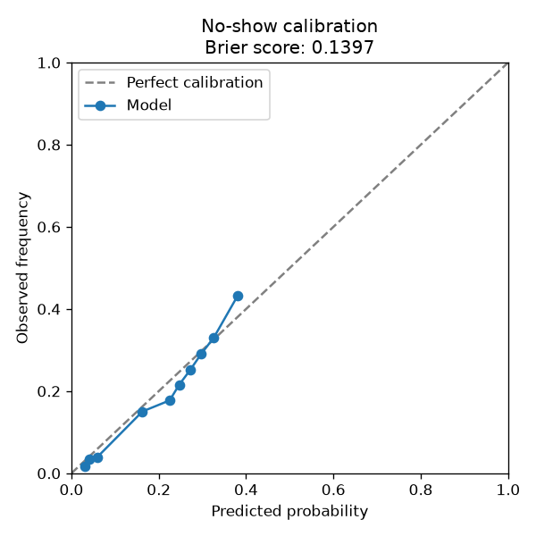

# Model card: No-show risk

Generated 2026-09-28 · model version `noshow-v1`

> Decision support for clinicians only. Not for diagnosis. Patients never see this score (SPEC clinical safety rule 4).

## Intended use

Decision support predicting appointment no-show risk, used to assign the reminder-strategy A/B experiment (SPEC 6.4) to high-risk appointments. Not a diagnosis, and never shown to patients (SPEC clinical safety rule 4).

## Data provenance

Medical Appointment No-Shows dataset (public clinics in Brazil), 110,526 real de-identified appointments, 62,298 unique patients. Brazilian clinics, not UAE -- this demonstrates method, not UAE clinical performance (see README honesty note).

## Metrics

| Metric | Lead-time rule (logistic regression on lead time alone) (baseline) | Main model |
| --- | --- | --- |
| AUROC | 0.7 | 0.7384 |
| AUPRC | 0.298 | 0.3694 |
| Brier | 0.2349 | 0.1397 |
| Recall@top10% | — | 0.2229 |

## Subgroup fairness

### By `gender`

Max auroc gap across subgroups: **0.0032**  
Max brier gap across subgroups: **0.0007**

| Group | n | auroc | brier |
| --- | --- | --- | --- |
| F | 14439 | 0.7375 | 0.1394 |
| M | 7667 | 0.7406 | 0.1401 |

### By `age band`

Max auroc gap across subgroups: **0.0843**  
Max brier gap across subgroups: **0.0520**

| Group | n | auroc | brier |
| --- | --- | --- | --- |
| 0-11 | 3922 | 0.7529 | 0.1403 |
| 12-17 | 1417 | 0.6974 | 0.1717 |
| 18-29 | 3235 | 0.7347 | 0.1556 |
| 30-44 | 4390 | 0.7594 | 0.1427 |
| 45-59 | 4794 | 0.7044 | 0.1320 |
| 60-74 | 3127 | 0.6750 | 0.1197 |
| 75+ | 1221 | 0.7067 | 0.1287 |

## Known limitations

- Trained on Brazilian public-clinic appointments; not validated on UAE populations.
- SMS_received reflects a reminder already sent for that historical appointment -- in live pre-visit scoring (before any reminder decision) this field is not yet known and the FHIR feature mapper defaults it, lowering the confidence badge (SPEC 6.3).
- Not for diagnosis, triage, or any use visible to patients.

---
_Generated by `ml/no-show_risk` training script, 2026-09-28T13:16:15+00:00._