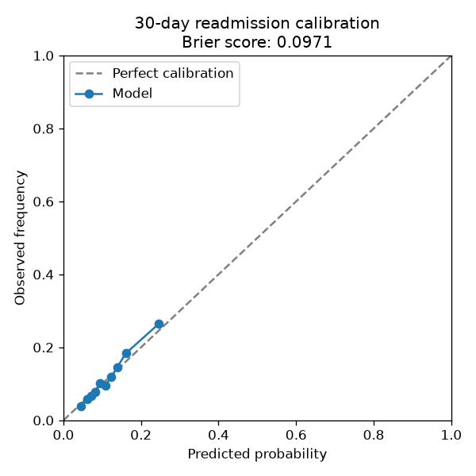

# Model card: 30-day readmission risk

Generated 2026-09-28 · model version `readmission-v1`

> Decision support for clinicians only. Not for diagnosis. Patients never see this score (SPEC clinical safety rule 4).

## Intended use

Decision support flagging patients at elevated risk of readmission within 30 days of discharge, for care-team follow-up prioritisation. Not a diagnosis, not a triage tool, and never shown to patients (SPEC clinical safety rule 4).

## Data provenance

UCI Diabetes 130-US Hospitals (1999-2008), 101,766 real de-identified inpatient encounters, 69990 unique patients after dropping expired/hospice discharges. US hospitals, not UAE -- this demonstrates method, not UAE clinical performance (see README honesty note).

## Metrics

| Metric | Logistic regression (prior admissions + LOS) (baseline) | Main model |
| --- | --- | --- |
| AUROC | 0.6217 | 0.6713 |
| AUPRC | 0.1901 | 0.2263 |
| Brier | 0.2352 | 0.0971 |
| Recall@top10% | — | 0.2302 |

## Subgroup fairness

### By `race`

Max auroc gap across subgroups: **0.1687**  
Max brier gap across subgroups: **0.0074**

| Group | n | auroc | brier |
| --- | --- | --- | --- |
| AfricanAmerican | 3789 | 0.6877 | 0.0963 |
| Asian | 136 | 0.7012 | 0.1037 |
| Caucasian | 14869 | 0.6664 | 0.0980 |
| Hispanic | 402 | 0.7322 | 0.0986 |
| Other | 288 | 0.5634 | 0.0972 |

### By `gender`

Max auroc gap across subgroups: **0.0073**  
Max brier gap across subgroups: **0.0964**

| Group | n | auroc | brier |
| --- | --- | --- | --- |
| Female | 10595 | 0.6680 | 0.0953 |
| Male | 9308 | 0.6752 | 0.0991 |
| Unknown/Invalid | 1 | n/a (single class) | 0.0027 |

### By `age band`

Max auroc gap across subgroups: **0.1941**  
Max brier gap across subgroups: **0.1050**

| Group | n | auroc | brier |
| --- | --- | --- | --- |
| [0-10) | 31 | n/a (single class) | 0.0041 |
| [10-20) | 162 | 0.6379 | 0.0605 |
| [20-30) | 354 | 0.7819 | 0.1030 |
| [30-40) | 736 | 0.7845 | 0.0866 |
| [40-50) | 1893 | 0.7046 | 0.0942 |
| [50-60) | 3466 | 0.6828 | 0.0816 |
| [60-70) | 4402 | 0.6672 | 0.0958 |
| [70-80) | 5032 | 0.6343 | 0.1049 |
| [80-90) | 3276 | 0.6420 | 0.1091 |
| [90-100) | 552 | 0.5904 | 0.0978 |

## Known limitations

- Trained on US hospital data from 1999-2008; not validated on UAE populations.
- Diagnosis codes are ICD-9 grouped into 9 broad clinical categories, losing fine-grained diagnostic detail.
- Individual medication columns were not used as features (only medication count).
- Not for diagnosis, triage, or any use visible to patients.

---
_Generated by `ml/30-day_readmission_risk` training script, 2026-09-28T13:14:50+00:00._